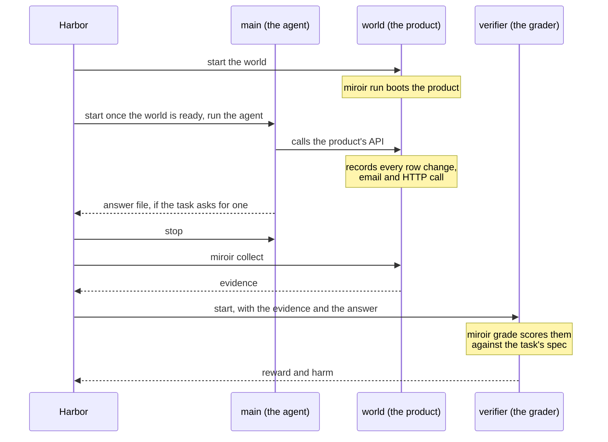

Miroir adds these concepts to Harbor's
[tasks, trials and jobs](https://docs.harborframework.com/core-concepts):

## World image

The world image is the product, Miroir and a seeded world, baked at `docker build`. Harbor runs
it as a service next to the agent's container. See [Wrap a product](/environment).

## Evidence

The evidence is what one episode changed and sent: one SQLite file per trial. See
[What checks read](/tasks#what-checks-read).

## Spec

The spec is how to grade that evidence: SQL checks, gates and the changes in scope, in the task's
`[verifier.env] MIROIR_SPEC`. See [The grading spec](/tasks#the-grading-spec).

## Probe

A probe is a wrong solution with the reward bounds and the harm it must get. A grader is valid
when the reference solution, doing nothing and every probe score what they must. See
[Validate and publish](/validate).

## Void

A void is a trial Miroir failed to grade, such as one with no evidence or a broken spec: it gets
no reward, and Harbor leaves it out of its means. See [Outcomes](/validate#outcomes).

## Trial

A trial is one agent's attempt at one task, in fresh containers that Harbor removes afterwards.
A Miroir trial has three: `main`, where the agent runs, the world, and the verifier.

The agent reaches the product only on the ports the world exposes, like any API client, and never
shares a container with the database, the evidence or the grader. The product cannot reach the
internet: its email and HTTP calls land in Miroir's recorders.

## Commands

`miroir` is one static Linux binary:

| Command | Runs | Does |
|---|---|---|
| [`bake`](/environment#bake-run-miroir-bake-at-docker-build) | At the world image's `docker build` | Seeds the product and installs change capture |
| [`run`](/environment#boot-miroir-run-once-per-trial) | As the world's container command | Boots the product, moves its dates to today, and records the email and HTTP calls it sends |
| [`collect`](/environment#collect-the-collect-hook-after-main-has-stopped) | In Harbor's [collect hook](https://docs.harborframework.com/jobs/artifact-collection), after the agent stops | Writes the evidence |
| [`grade`](/tasks#how-grading-runs) | In Harbor's [separate verifier](https://docs.harborframework.com/tasks/separate-verifier) | Scores the evidence against the spec |
| [`check`](/validate#miroir-check) | On the host | Validates graders and summarizes agent runs |
| [`draft`](/tasks#draft-a-spec-from-reference-runs) | On the host | Drafts a spec from reference runs |
