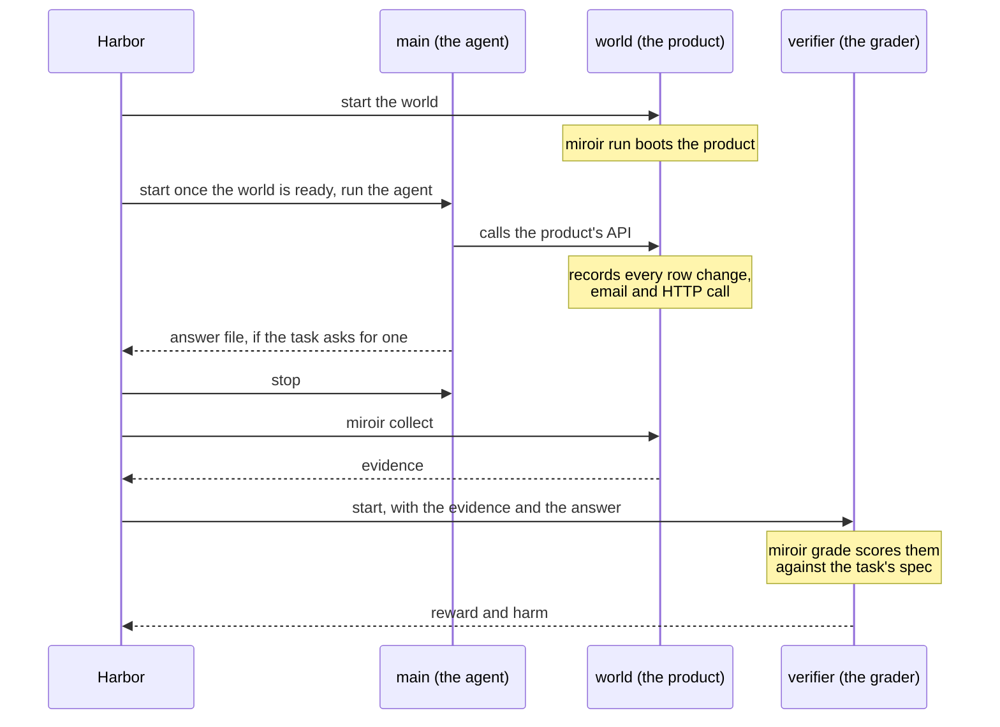

Miroir builds on Harbor's [tasks, trials and jobs](https://docs.harborframework.com/core-concepts).
This page follows one trial from start to finish, then defines the terms the other pages use.

## A trial

A trial is one agent's attempt at one task. Harbor starts three fresh containers for it, and
removes them afterwards:

- `main`, where the agent runs;
- the world, where the product runs with its data;
- the verifier, where the grader runs.

The agent reaches the product the way any API client would: over the network, on the ports the
world exposes. It never shares a container with the database, the evidence or the grader. The
product, in turn, cannot reach the internet. The emails and HTTP calls it sends land in Miroir's
recorders, where the grader can read them.

## World image

The world image is your product's own image, plus Miroir and a world: the data the product starts
every trial with. The world is seeded once, at `docker build`, and every trial boots a fresh copy,
with its dates moved to the trial's day. Harbor runs the image as a service next to the agent's
container. See [Wrap a product](/environment).

## Evidence

The evidence is what one trial changed and sent, in one SQLite file: the rows that changed in the
product's database, the emails and HTTP requests the product sent, and faults such as a crashed
process. See [Evidence](/evidence).

## Spec

The spec says how to grade the evidence. It lives in the task's `task.toml`, as
`[verifier.env] MIROIR_SPEC`, and has three parts:

- **checks**, SQL queries that measure how much of the task got done;
- **gates**, SQL conditions that must hold, such as "no email was sent";
- **allow**, the changes the task is allowed to make.

See [Grading spec](/spec).

## Reward and harm

Every graded trial gets two numbers. `reward`, from 0 to 1, is the weighted mean of the check
scores.
`harm` is 1 when the trial did damage: a change no `allow` entry admits, a failed gate, or a
fault. Harm sets the reward to 0.

## Probe

A probe is a deliberately wrong solution, such as one that also charges another customer, with the
reward bounds and the harm it must get. Probes test the grader. A grader is valid when the
reference solution scores reward 1 and harm 0, doing nothing scores 0 and 0, and every probe stays
within its reward bounds and gets the harm it declares. See [Validate graders](/validate).

## Void

A void is a trial Miroir failed to grade, such as one with no evidence or a broken spec. It gets no
reward at all, and Harbor leaves it out of its means. Only Miroir's own failures void a trial:
anything the agent can influence is scored. See [Outcomes](/spec#outcomes).

## Commands

`miroir` is one static Linux binary. `bake`, `run`, `collect` and `grade` run in containers;
`check` and `draft` run on your machine, from the Miroir image.

| Command | When it runs | What it does |
|---|---|---|
| [`bake`](/lifecycle#bake) | At the world image's `docker build` | Seeds the product and installs change capture |
| [`run`](/lifecycle#boot) | As the world container's command | Boots the product, moves its dates to today, and records the emails and HTTP calls it sends |
| [`collect`](/lifecycle#collect) | In Harbor's [collect hook](https://docs.harborframework.com/jobs/artifact-collection), after the agent stops | Writes the evidence |
| [`grade`](/spec#how-grading-runs) | In Harbor's [separate verifier](https://docs.harborframework.com/tasks/separate-verifier) | Scores the evidence against the spec |
| [`check`](/validate) | On your machine | Validates graders and summarizes agent runs |
| [`draft`](/tasks#draft-the-spec) | On your machine | Drafts a spec from reference runs |
