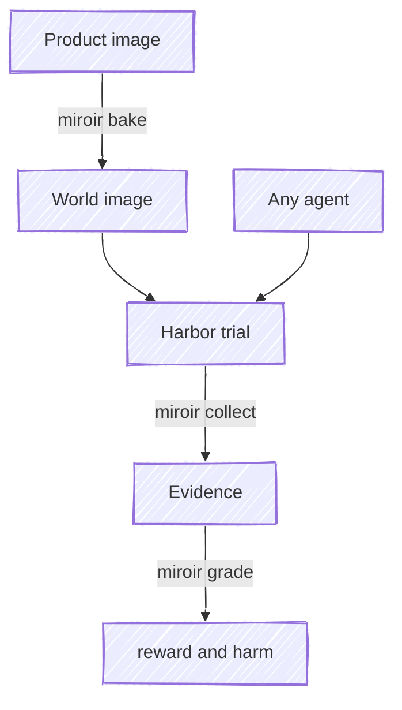

Miroir turns a real product's container image into [Harbor](https://docs.harborframework.com)
environments graded from what the agent actually did to the product: the database rows it
changed, the emails and HTTP calls the product sent, and the answer it gave. Collateral damage is
reported as `harm` next to `reward`.

Miroir adds only what Harbor cannot do: run a multi-process product with a seeded world in one
image, capture its changes and side effects below the API, and grade that evidence in Harbor's
separate verifier. Harbor runs everything else, and Miroir never wraps `harbor run`: every
command you run against a trial is a Harbor command.

<CardGroup cols={2}>
  <Card title="Quick start" icon="zap" href="/quick-start">
    Build a small CRM world and validate its graders through Harbor.
  </Card>
  <Card title="Core concepts" icon="book-open" href="/core-concepts">
    World images, evidence, specs, probes, voids, and one trial.
  </Card>
  <Card title="Wrap a product" icon="package" href="/environment">
    Turn a product's container image into a world.
  </Card>
  <Card title="Write tasks" icon="square-pen" href="/tasks">
    The instruction, the reference solution, probes and the grading spec.
  </Card>
</CardGroup>

## Who it is for

- Product and platform teams that evaluate or train their own agent on their own product, with
  realistic data, a harm number next to the success number, and a CI gate.
- Publishers shipping the official environment of their product: a world image and a Harbor
  dataset that run wherever Harbor runs, with a release gate.
- Labs and RL teams that train on those datasets with their own Harbor stack, and use
  `miroir check` to pick the tasks worth training on.

## What Miroir is not

- Not a layer between the agent and the product. The agent calls the product's own API at
  `http://<service>:<port>` with a test credential written in its instruction. Miroir ships no
  gateway and no tools; a product's own MCP server can still be evaluated
  ([Write tasks](/tasks#an-mcp-server-the-product-ships)).
- Not a task format. Tasks are plain Harbor task directories, written by hand or by a generator.
- Not a judge of prose. Checks are deterministic SQL over the evidence; the quality of a written
  comment is approximated at best.
- Not a scrubber. A production snapshot is scrubbed before it leaves its network; Miroir restores
  the scrubbed dump ([From production](/environment#from-production)).
- Not multi-step. One instruction per task, graded once at the end.
- Postgres only, one product per image, and one world per image.
