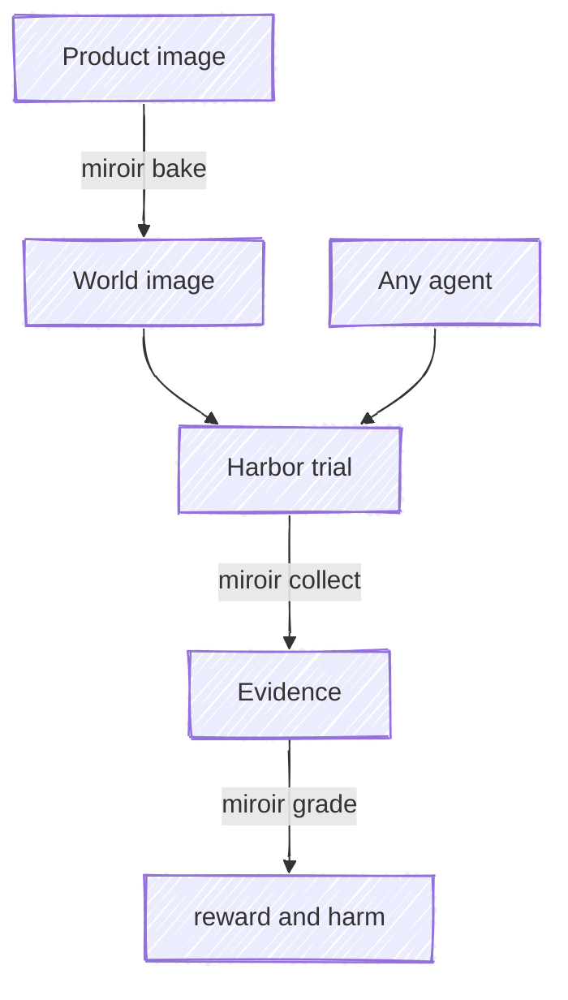

Miroir turns a real product's container image into a [Harbor](https://docs.harborframework.com)
benchmark environment. Instead of relying on LLM judges or mock APIs, Miroir grades agents on
**what they actually did to the product**: database rows altered, outbound emails and HTTP
requests sent, and the answer they gave. Unintended side effects are scored as `harm` alongside
task `reward`.

Miroir handles only what Harbor doesn't: packaging a multi-process product with seeded state into
a single image, capturing low-level side effects during execution, and grading that evidence
inside Harbor's verifier. Harbor orchestrates the rest. Miroir never wraps `harbor run`, so
standard Harbor commands work out of the box.

<CardGroup cols={2}>
  <Card title="Quick start" icon="zap" href="/quick-start">
    Build a small CRM world and test its graders through Harbor.
  </Card>
  <Card title="Core concepts" icon="book-open" href="/core-concepts">
    What happens during a trial, and the terms the docs use.
  </Card>
  <Card title="Wrap a product" icon="package" href="/environment">
    Turn your product's container image into a world.
  </Card>
  <Card title="Write tasks" icon="square-pen" href="/tasks">
    The instruction, the reference solution, probes and the grading spec.
  </Card>
</CardGroup>

## Who it is for

- **Product & platform teams**: Evaluate or train agents against your real product with realistic
  data, safety metrics (harm), and CI gating.
- **Environment publishers**: Ship official, portable world images and Harbor datasets with
  automated release gates.
- **RL & research labs**: Train on Harbor datasets using your own stack, and filter for
  high-signal tasks with `miroir check`.

## Scope & boundaries

- **Direct agent access**: Miroir isn't a proxy or tool gateway. Agents talk directly to the
  product at `http://<service>:<port>`, using test credentials provided in the task instruction.
  A product's own MCP server can be evaluated too
  ([Write tasks](/tasks#an-mcp-server-the-product-ships)).
- **Standard Harbor tasks**: Miroir does not invent a new task format. Tasks are standard Harbor
  directories, authored manually or generated.
- **Deterministic grading**: Verifiers run SQL queries over captured evidence, not LLM-as-a-judge
  evaluations of free-form prose.
- **Bring your own scrubbed data**: Miroir restores database dumps, but you must scrub sensitive
  production data before importing it ([From production](/environment#from-production)).
- **Single-turn evaluation**: Each task consists of one instruction, graded once upon completion.
- **Current constraints**: Postgres only, with one product and one seeded world per container
  image. This may evolve: pull requests are welcome.
